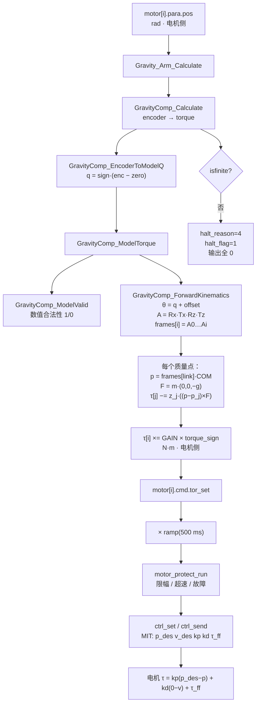

# 第一步：读代码、参数与坐标系（雅可比任务书第二节）

本文对应 `JACOBIAN_LEARNING_TASK.md` 第二节的三项交付：

1. 机械臂轴线及坐标系示意图 → `docs/frames_q0.png`、`docs/frames_home.png`
2. 参数/映射表 → 本文第二节
3. 函数数据流图 → 本文第四节

所有数值都从 [robot_parameters.h](../User/gravity/robot_parameters.h) 解析得到，
图由 [tools/plot_frames.py](../tools/plot_frames.py) 生成；改参数后重新运行
`python tools/plot_frames.py` 即可刷新，不需要手改图。

---

## 一、函数清单：输入、输出、单位、坐标系

### 1.1 接入层 `User/gravity/gravity.c`

| 函数 | 输入 | 输出 | 单位 | 坐标系 |
| --- | --- | --- | --- | --- |
| `Gravity_Arm_Calculate(float torque_cmd[6])` | `motor[i].para.pos`（6 个电机反馈角） | `torque_cmd[6]` 补偿力矩 | rad → N·m | 输入是**电机编码器原始角**（未去零位、未乘方向）；输出是**电机侧**力矩（已乘 `GRAVITY_COMP_GAIN` 与 `torque_sign`） |
| `Gravity_Arm_Run(void)` | 同上 | 直接写 `motor[i].cmd.tor_set` | N·m | 同上 |

任一轴算出 `NaN/Inf` 时：`global_halt_reason = 4`、`global_halt_axis = i`、
`global_system_halt_flag = 1`，并把 6 个输出全部清 0——**不把失败当成"零补偿"**。

### 1.2 模型层 `User/gravity/gravity_comp.c`

| 函数 | 输入 | 输出 | 单位 | 坐标系 |
| --- | --- | --- | --- | --- |
| `GravityComp_ModelValid()` | 无（读编译期常量表） | 1 = 合法 / 0 = 非法 | — | — |
| `GravityComp_EncoderToModelQ(encoder[6], q[6])` | 编码器角 | 模型关节角 | rad → rad | 电机侧 → 模型侧（q = 0 为参数标定时的参考姿态） |
| `GravityComp_ForwardKinematics(q[6], frames[6])` | 模型关节角 | 6 个 4×4 齐次变换 | rad → m | 每个 `frames[i]` 都是**相对底座 {0}** 的位姿，平移单位 m，旋转无量纲 |
| `GravityComp_ModelTorque(q[6], torque[6])` | 模型关节角 | 模型力矩，返回 1/0 | rad → N·m | **模型侧**，不含增益、不含 `torque_sign` |
| `GravityComp_Calculate(encoder[6], torque[6])` | 编码器角 | 电机侧力矩 | rad → N·m | 电机侧，已乘增益与 `torque_sign`；失败时整组填 `NAN` |

`ModelValid` 只拦非法数值（增益不在 [0,1]、符号不是 ±1、`link_index` 不在 [-1,5]、
质量为负、DH/COM 非有限），**不证明几何正确**——填错了 a 或 COM 它照样返回 1。

### 1.3 数学层 `User/gravity/gravity_math.c`

| 函数 | 输入 | 输出 | 单位 | 说明 |
| --- | --- | --- | --- | --- |
| `GravityMath_Identity()` | — | 4×4 单位阵 | — | FK 初值 |
| `GravityMath_DH(a, alpha, d, theta)` | a、d；alpha、theta | 单个关节的 4×4 变换 | m、rad | 实现 `Rx(α)Tx(a)Rz(θ)Tz(d)` |
| `GravityMath_Mat4Mul(A, B)` | 两个 4×4 | 4×4 | — | 参数按值传递，每周期 6 次拷贝 |
| `GravityMath_TransformPoint(T, p)` | T；p 在 T 所属坐标系 | 点在该坐标系参考系（底座）中的坐标 | m、m | 用来把 COM 从连杆坐标变换到底座 |
| `GravityMath_GetTranslation(T)` | 4×4 | 原点位置 | m | 取第 4 列 |
| `GravityMath_GetZAxis(T)` | 4×4 | 关节轴单位向量 | — | 取旋转矩阵第 3 列，在底座坐标下 |
| `GravityMath_Sub / Scale / Cross / Dot` | 向量 | 向量 / 标量 | m、N、N·m | `Cross` 算力矩 `r × F` |

### 1.4 调用时机 `User/1-APL(Application Layer)/src/fsm.c`

`motor_par_send()` 每个控制周期（TIM3，约 100 Hz）执行：

```text
Gravity_Arm_Run()              算补偿力矩，写 cmd.tor_set
  → ramp                      tor_set ×= min(上电后时间/500 ms, 1)
  → motor_protect_run()       限幅、超速/故障处理（可能置熔断标志）
  → calib_capture_run()       标定快照（只读）
  → ctrl_set() / ctrl_send()  组 MIT 帧并发送
```

电机实际出力是 `τ = kp·(pos_set − pos) + kd·(0 − vel) + tor_set`。
`tor_set` 只是前馈，`kp/kd` 由状态机给：锁定用 kp≈40 起、随重力矩微调，
自由拖动用 `kp=0, kd=MOTOR_FLOAT_KD`。

---

## 二、参数/映射表

### 2.1 六轴 DH 与映射（当前固件实际数值）

| 关节 | a (m) | alpha (rad) | d (m) | theta_offset (rad) | encoder_zero (rad) | position_sign | torque_sign |
| --- | --- | --- | --- | --- | --- | --- | --- |
| J0 | 0.0 | 0.0 | 0.042 | 0.0 | 0.3 | +1 | +1 |
| J1 | 0.0 | −1.570796 | −0.022 | −1.583297 | −1.5 | −1 | −1 |
| J2 | 0.120 | −3.141593 | −0.0293 | −0.0125 | −1.65 | −1 | −1 |
| J3 | 0.083 | −1.570796 | −0.111 | 0.0 | −0.2 | +1 | +1 |
| J4 | 0.0 | −1.570796 | 0.0075 | 3.141593 | 0.01 | +1 | +1 |
| J5 | 0.0 | −1.570796 | −0.080 | −1.570796 | 0.0 | +1 | +1 |

### 2.2 质量点（重力模型专用）

| 点 | 质量 (kg) | 所属连杆 `link_index` | 在哪一坐标系 | COM (m) |
| --- | --- | --- | --- | --- |
| J0 | 0.32 | −1（底座） | — | (−0.00006, 0, −0.03446) |
| J1 | 0.32 | 0 | {1} | (−0.00006, −0.01046, −0.00001) |
| J2 | 0.44 | 1 | {2} | (0.11994, −0.00002, 0.02946) |
| J3 | 0.44 | 2 | {3} | (0.08294, −0.01146, −0.00001) |
| J4 | 0.44 | 3 | {4} | (−0.00006, −0.01046, −0.00001) |
| J5 | 0.44 | 4 | {5} | (−0.00006, −0.008, −0.00002) |

J0 挂在底座上，对任何关节都不产生力矩（代码里 `link == -1` 直接 `continue`）。
J2~J5 的 0.44 kg 是"电机 + 连杆"的等效质量，由六组锁定姿态的力矩拟合得到，
不是电机铭牌质量；J5 的 COM_Y 也是按 J4 单独旋转的实验拟合到 −0.008。

### 2.3 哪些参数影响什么（任务书要回答的问题）

| 参数 | 影响末端位置/雅可比 | 影响重力力矩 | 只影响电机输出 |
| --- | :---: | :---: | :---: |
| `a`、`alpha`、`d`、`theta_offset` | ✅ | ✅（通过 FK） | — |
| `encoder_zero`、`position_sign` | ✅（决定 q） | ✅（决定 q） | — |
| `mass`、`link_index`、`COM` | ❌ | ✅ | — |
| `torque_sign` | ❌ | ❌ | ✅ |
| `GRAVITY_COMP_GAIN` | ❌ | ❌（乘在最后） | ✅ |

**做雅可比时只关心第一、二行**：质量、质心、增益、力矩方向都不进入运动学。
反过来说，你改 `mass` 或 `COM` 不会动末端位置，改 `a/d/alpha` 会同时动
末端位置和重力模型——这也是为什么校准重力时拟合质量、而不要随手改 DH。

### 2.4 可用于校验自己实现的参考值

把 q 全置 0，按本仓库公式算出的各坐标系原点（底座坐标，m）：

| 坐标系 | 原点 (m) | z 轴（关节轴，底座坐标） |
| --- | --- | --- |
| {0} 底座 | (0, 0, 0) | — |
| {1} | (0, 0, 0.042) | (0, 0, 1) |
| {2} | (0, −0.022, 0.042) | (0, 1, 0) |
| {3} | (−0.0015, 0.0073, 0.162) | (0, −1, 0) |
| {4} | (0.1095, 0.0073, 0.245) | (−1, 0, 0) |
| {5} | (0.1095, 0.0148, 0.245) | (0, 1, 0) |
| {6} | (0.1895, 0.0148, 0.245) | (−1, 0, 0) |

Python 版实现跑出这组数，就说明 DH 约定、索引和乘法顺序都对了。

物理"回零"姿态（电机编码器 = 0）对应的模型角是
`q = −position_sign × encoder_zero = [−0.300, −1.500, −1.650, 0.200, −0.010, 0.000]`，
**不是** q = 0。两者相差 1.5 rad 以上，画图和验证码盘时别混用。

---

## 三、关系式与本仓库的约定

```text
q[i]     = position_sign[i] * (encoder[i] - encoder_zero[i])
theta[i] = q[i] + theta_offset[i]
A[i]     = Rx(alpha[i]) Tx(a[i]) Rz(theta[i]) Tz(d[i])
frames[i]= A[0] A[1] ... A[i]
```

- **J0 是第一个电机**；底座是 {0}；`frames[0]` 是过 J0 之后的 {1}，
  `frames[5]` 是 {6}（末端）。数组里**没有**底座 {0} 这一项。
- `frames[i]` 是坐标系 {i+1} 在底座 {0} 中的位姿，平移单位 m。
- 本模板**没有** `model_offset` 字段。旧工程里单独的 `model_offset`
  在这里已经并进 `theta_offset`，**不要照搬别的工程的映射公式**。
- 矩阵形式 `Rx(α)·Tx(a)·Rz(θ)·Tz(d)` 属于 **Craig 改进 DH（modified DH）**；
  标准 DH 是 `Rz(θ)·Tz(d)·Tx(a)·Rx(α)`，两者差的正是左右乘顺序。
  判断方法：看 `gravity_math.c` 里 `GravityMath_DH` 的矩阵——第一列是
  `(cosθ, sinθ·cosα, sinθ·sinα)`，平移是 `(a, −sinα·d, cosα·d)`，就是改进 DH。

---

## 四、数据流图



纯文本版（粘进 Word 用）：

```text
motor[i].para.pos (rad, 电机侧)
        │
        ▼
Gravity_Arm_Calculate ──► GravityComp_Calculate
        │                        │
        │            EncoderToModelQ: q = sign·(enc−zero)  (rad, 模型侧)
        │                        │
        │            ModelTorque │ 失败(NaN) ──► halt_reason=4, 输出全 0
        │                        ▼
        │            ForwardKinematics: A_i = Rx·Tx·Rz·Tz
        │                               frames[i] = A0…Ai  ({i+1} 相对 {0})
        │                        ▼
        │            重力矩: τ[j] −= z_j · ((p_com − p_j) × m·g)
        │                        ▼
        │            τ[i] ×= GAIN × torque_sign   (N·m, 电机侧)
        ▼
motor[i].cmd.tor_set ──► ×ramp(500 ms) ──► motor_protect_run
        ──► ctrl_set/ctrl_send ──► MIT 帧 ──► 电机 τ = kpΔp + kdΔv + τ_ff
```

---

## 五、轴线与坐标系示意图

- `docs/frames_q0.png`：模型参考姿态 q = 0
- `docs/frames_home.png`：物理回零姿态（编码器 = 0）

蓝线是每个关节的旋转轴（`frames[i]` 的 z 轴，双箭头表示可正反转），
红/绿是 x/y 轴，橙点是重力模型用的质心，灰线是连杆中心线。

**看这两张图的用处**：q = 0 那张是 DH 参数本身定义出来的姿态；home 那张是
你实际回零后手臂的姿态。两张差得越多，说明编码器零位离 DH 参考姿态越远，
越要确认 `encoder_zero` 和 `position_sign` 没填反——这正是后面做雅可比时
最容易出错的地方。

---

## 六、`tools/test_gravity_model.py` 在验证什么，不验证什么

它把生产代码 `gravity_math.c` / `gravity_comp.c` 直接编译，但**用自己的合成参数**
覆盖 `GRAVITY_DH`、`GRAVITY_JOINT_MAP`、`GRAVITY_MOTOR_MASS`，然后检查：

| 检查 | 构造 | 期望 |
| --- | --- | --- |
| 解析解 | alpha=+90° 把 J0 轴放平，2 kg 质心在 (0.4,0,0) | τ0 = m·g·x = 7.84 N·m |
| 轴线上质量 | 质心在 (0,0,0.4)（沿 z 轴） | τ0 = 0 |
| 归属 | 质量挂在连杆 L | 只对 0…L 关节产生力矩，下游关节为 0 |
| 底座质量 | `link_index = −1` | 全部为 0 |
| 非法索引 | `link_index = 6 / −2` | 返回失败 |
| 角度映射 | sign=−1、zero=0.2 | q = −(enc−0.2) |
| 势能差分 | 30 组随机姿态 | τ_i ≈ ∂U/∂q_i，U = Σ m·g·z_com，误差 < 0.008 |

**为什么它不验证真实机械臂尺寸**：所有 DH 和质量都是脚本里现造的，
它证明的是"矩阵约定、取轴、叉乘方向、力矩归属、映射公式"这套代数没写错；
真实的 a、d、alpha、COM 填错了它一点都发现不了。真实尺寸只能靠
回零姿态 + 多个锁定姿态的实测力矩对比来验证（也就是前面拟合 0.44 kg 的那一步）。

`--reference-root` 模式则是和旧工程模型逐位对比，把旧 `model_offset` 并进
`theta_offset` 后要求 100 组姿态误差 < 2e-5——那是**迁移等价性**，不是物理验证。

---

## 七、下一步

先读 [jacobian_principle.md](jacobian_principle.md)（原理页，含 q=0 的六列手算表）。

有了上面这套 `frames[i]`，位置雅可比就是逐列取
`Jv[:, i] = z_i × (p_末端 − p_i)`（z_i、p_i 取 `frames[i]` 的第 3 列和第 4 列），
再用 `delta_p ≈ Jv·delta_q` 和有限差分互相验证。注意本任务只做 Python/NumPy
层面的实现与验证，**不接进电机运动或力矩闭环**。
